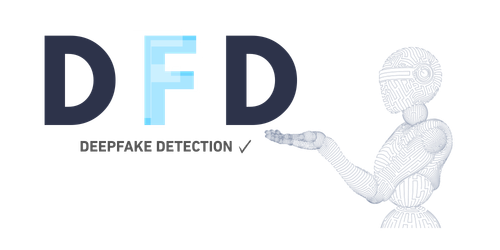

  

# Deepfake Detection System (DFD)
A bilingual (Arabic/English) web app that classifies uploaded images and videos as real or manipulated. Capstone project for the B.Sc. in Cybersecurity (CYS 341), Onaizah Colleges, 2026.

**Live demo:** https://cys-deepfake-system.streamlit.app (the app may take ~30 seconds to wake up)

## How it works
Upload an image or video -> MTCNN detects the face -> a trained CNN scores it -> the app shows the result with a confidence value. The model focuses on faces only.

## Data and training
- Dataset: FaceForensics++ (70/15/15 train/validation/test split)
- Trained for 20 epochs with TensorFlow/Keras

## Baseline results

| Metric | Result |
|---|---|
| Overall accuracy | 64% |
| Recall (fake) | 85% |
| Recall (real) | 37% |

The model catches most manipulated media but also flags many real images as fake (1503 of 2385 real test images). It is a **first line of defense**, not a final verdict: results should be reviewed by a human.

## Limitations
- Video compression, strong lighting and extreme head poses reduce accuracy
- Only faces are processed; non-face manipulation is not detected
- Trained on one dataset, so generalisation to newer generators is limited

## Roadmap
- Explainable AI (heatmaps) to show why a decision was made
- More diverse data (for example DFDC) and periodic retraining
- Threshold calibration to reduce false positives on real media

## Run locally
    git clone https://github.com/Hussa-Almusayab/Deepfake-Detection-App.git
    cd Deepfake-Detection-App
    pip install -r requirements.txt
    streamlit run app.py

## Team
Dana Albaqmi · Hussa Almusayab · Jana Alaqeel · Leen Alshuaibi · Rama Alagili · Remas Almutairi

Supervisor: Dr. Hanan Abdullah Almutawa

## My contribution
The project was developed collaboratively by the team of six. I carried most of the hands-on implementation: I merged the initial work of the two sub-teams into one codebase, then we completed the system together, including model training and evaluation, the bilingual Streamlit interface, testing, and the final report and presentation.

---

**License:** MIT
